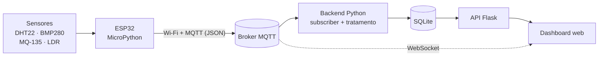
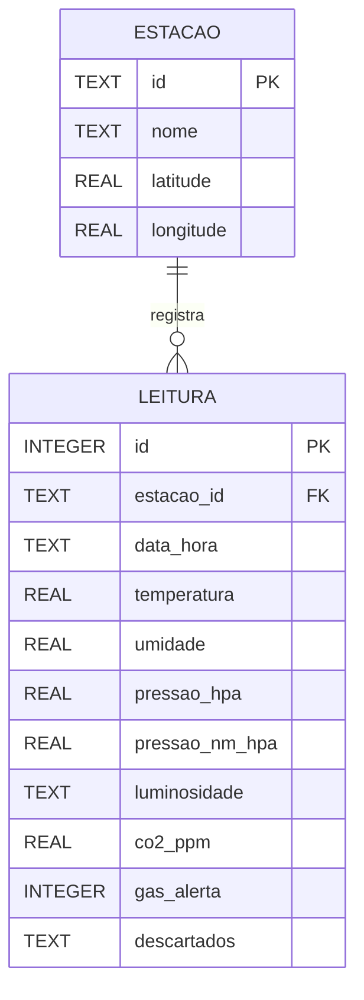

> **Vídeo de demonstração (não listado):** [assista aqui](COLE_AQUI_O_LINK_DO_YOUTUBE_OU_DO_DRIVE)

<div align="center">


# TechGirls Weather Station

**Uma estação meteorológica de baixo custo, aberta e feita para ser reproduzida**

Mede temperatura, umidade, pressão, qualidade do ar e luminosidade com um ESP32,
guarda os dados e mostra tudo num painel web com mapa, alertas e histórico.


</div>

--

## Sobre o projeto

### O problema

As cidades crescem, mas o monitoramento do clima e da qualidade do ar costuma depender de um número limitado de estações oficiais, o que deixa sem medição a realidade de cada bairro. Sem dados locais, fica difícil identificar problemas como o calor excessivo e o ar de má qualidade, e planejar ações para resolvê-los. Dados ambientais abertos permitem que a gestão urbana decida com base em evidências e que a população acompanhe e confie nas informações, o que fortalece a transparência e a participação.

### O que propomos

Uma estação meteorológica **de baixo custo**, construída com componentes comuns, que coleta os dados no próprio local e os publica em um painel público. Ela foi pensada como peça de uma **cidade inteligente**: cada estação a mais é um ponto novo de medição, e os dados ficam acessíveis a qualquer pessoa.

### Por que este projeto está no GitHub

Este é um projeto acadêmico (disciplina **68F3 – Projeto e Desenvolvimento II**, Ciência da Computação), e escolhemos deixá-lo **aberto** para que:

- **outras pessoas aprendam** com ele: o código é comentado e organizado em módulos;
- **outras pessoas reproduzam** a estação, em escolas, laboratórios, bairros ou cidades diferentes;
- **outras pessoas melhorem** o projeto, com novas ideias, sensores e correções;
- os dados e o código fiquem **transparentes** e possam ser conferidos por qualquer pessoa.

### Para quem é

Estudantes e professores de eletrônica e programação, makers, escolas, grupos de pesquisa e quem quer acompanhar o clima do próprio bairro.

---

## Como funciona



1. O **ESP32** lê os sensores a cada intervalo e envia um JSON pelo Wi-Fi, usando o protocolo MQTT.
2. O **backend em Python** recebe a mensagem, descarta valores impossíveis ou fora da curva e grava no banco.
3. O **dashboard** mostra os valores ao vivo, o histórico, os alertas e a localização da estação.

### O dashboard

<p align="center">
  
</p>

<p align="center">
  
</p>

<p align="center">
  
</p>

<p align="center">
  
  
</p>

---

## Hardware

| Sensor | Grandeza | Interface | Pino do ESP32 |
|---|---|---|---|
| **DHT22** | temperatura e umidade | 1 fio digital + resistor de 4,7 kΩ | GPIO 15 |
| **BMP280** | pressão atmosférica | I²C (0x76) | SDA GPIO 21 · SCL GPIO 22 |
| **MQ-135** | qualidade do ar (CO₂ estimado) | analógica com divisor 10 kΩ / 20 kΩ · digital | AOUT GPIO 34 · DOUT GPIO 23 |
| **Módulo LDR** | luminosidade (claro ou escuro) | saída digital | GPIO 32 |

> [!NOTE]
> Lógica em **3,3 V** (DHT22, BMP280, LDR) e **5 V** no pino VIN só para o aquecedor do MQ-135.
> O AOUT do MQ-135 passa por um divisor de tensão (5 V → 3,33 V), abaixo do limite de 3,6 V do pino.

**Fotos do protótipo:** [adicione as fotos em `docs/fotos/` e descomente as linhas abaixo]

<!--
<p align="center">
  
  
</p>
-->

---

## Quer reproduzir? O que você vai precisar

**Componentes**
- 1 placa **ESP32** (DevKit) e cabo USB que transfere dados
- 1 sensor **DHT22** e 1 resistor de 4,7 kΩ
- 1 sensor **BMP280** (módulo I²C)
- 1 sensor **MQ-135** e 2 resistores (10 kΩ e 20 kΩ) para o divisor de tensão
- 1 **módulo LDR**
- protoboard, jumpers e uma fonte de 5 V (1 A ou mais) para deixar ligado

**Software**
- [Python 3.9+](https://www.python.org/) e [VS Code](https://code.visualstudio.com/) (com a extensão Python)
- [Thonny](https://thonny.org/) para gravar o programa na placa
- Uma rede Wi-Fi de **2,4 GHz**

---

## Instalação

<details>
<summary><b>1. Firmware (ESP32)</b></summary>

1. Grave o MicroPython na placa (uma vez):

   ```bash
   esptool.py --chip esp32 erase_flash
   esptool.py --chip esp32 write_flash -z 0x1000 <arquivo-do-firmware>.bin
   ```

2. Copie `firmware/segredos.example.py` para `firmware/segredos.py` e preencha o Wi-Fi.
3. Em `firmware/config.py`, confira `SIMULADOR = False` e o `MQTT_TOPICO` (igual ao do dashboard e da API).
4. No Thonny (Arquivo › Salvar como › Dispositivo MicroPython), ou com `mpremote cp`, grave **todos** os arquivos de `firmware/` na placa, com os mesmos nomes. O `main.py` por último.
5. Aperte **F5** no `main.py`. O Shell deve mostrar `Wi-Fi conectado` e `Publicado no topico`.
6. Depois dos testes, troque `INTERVALO_S` de 10 para 60.

</details>

<details>
<summary><b>2. Backend e dashboard (computador)</b></summary>

No VS Code, abra a pasta do repositório e use **Terminal › Executar Tarefa**:

1. `2. Instalar dependências da API (só na primeira vez)`
2. `3. Ligar API + site`
3. Abra **http://127.0.0.1:5050** no navegador.

Ou, pelo terminal:

```bash
cd backend
python -m venv venv
venv\Scripts\activate          # Windows  (macOS/Linux: source venv/bin/activate)
pip install -r requirements.txt
python app.py
```

**Sem a placa?** Rode `python simular_esp32.py` em outro terminal: ele envia leituras de teste, e o painel funciona normalmente.

</details>

> [!WARNING]
> Nunca envie `firmware/segredos.py` (senha do Wi-Fi) nem arquivos `.db` para o GitHub. O `.gitignore` já bloqueia os dois.

---

## Usando os dados da estação

A API é **somente leitura** e devolve JSON, então qualquer programa pode consumir os dados:

| Rota | O que entrega |
|---|---|
| `/api/saude` | estado da API, do banco e do MQTT |
| `/api/ultima` | leitura mais recente |
| `/api/leituras` | lista com filtros de dia, limite e média móvel |
| `/api/resumo` | mínimo, máximo e média do dia |
| `/api/estacoes` | estações cadastradas, com latitude e longitude |

```bash
curl "http://127.0.0.1:5050/api/leituras?limite=5&media_movel=3"
```

```js
const resposta = await fetch("http://127.0.0.1:5050/api/ultima");
const leitura = await resposta.json();
console.log(leitura.temperatura, leitura.umidade);
```

---

## Adapte para a sua cidade

- **Coordenadas:** troque a latitude e a longitude em `dashboard/JS/config.js` (`Estacao.ESTACAO`) para o mapa mostrar o seu local.
- **Tópico MQTT:** use um tópico só seu e igual no firmware, no backend e no dashboard. O broker público é aberto a todos.
- **Mais estações:** o banco já separa as leituras por estação (tabela `estacao`). Cada placa pode enviar o seu próprio identificador.
- **Novos sensores:** acrescente o campo no JSON do firmware, a faixa válida em `backend/banco.py` e o cartão no dashboard.
- **Alertas:** ajuste os limites em `Estacao.ALERTAS`, no `dashboard/JS/config.js`.

---

## Firmware

Código modular em MicroPython, na pasta [`firmware/`](firmware):

| Arquivo | Função |
|---|---|
| `main.py` | laço principal: lê os sensores, monta o JSON e envia |
| `config.py` | pinos, tópico MQTT, intervalo e constantes |
| `pressao.py` | driver do BMP280 |
| `mq135.py` | tensão → resistência → ppm de CO₂, com correção por temperatura e umidade |
| `rede.py` | Wi-Fi e publicação MQTT |
| `segredos.py` | nome e senha do Wi-Fi (**não vai para o GitHub**; use `segredos.example.py`) |

## Backend e banco de dados

A pasta [`backend/`](backend) (Python, Flask e SQLite) assina o MQTT, **trata os dados** e grava no banco relacional:

- **faixas físicas:** valores impossíveis (por exemplo, 500 °C) são rejeitados;
- **outliers:** comparação com as leituras recentes por mediana e MAD, com o campo removido registrado em `descartados`;
- **média móvel** nas consultas;
- `consultar_banco.py` mostra as leituras entrando no banco, em tempo real, pelo terminal.



## Dashboard

A pasta [`dashboard/`](dashboard) (HTML, CSS e JavaScript puro, sem bibliotecas) tem boletim ao vivo dos sensores, **alertas de condições extremas**, **mapa** com a posição da estação (projeção de Mercator), **histórico gravado no banco** com média móvel, modo escuro automático e layout responsivo.

---

## Estrutura do repositório

```text
TechGirlsWeatherStation/
├─ firmware/      programa do ESP32 (MicroPython)
├─ backend/       API em Python, tratamento de dados e banco SQLite
├─ dashboard/     site: index.html, CSS, JS e SRC
├─ docs/          imagens, fotos e GIFs usados neste README
├─ .vscode/       tarefas para ligar tudo com poucos cliques
└─ README.md
```

---

## Testes

> [!IMPORTANT]
> Os casos CT01 a CT04 devem seguir o definido pela disciplina. A tabela abaixo é uma sugestão de organização.

| Caso | O que valida | Evidência |
|---|---|---|
| CT01 | leitura dos sensores no Shell do Thonny | captura do terminal |
| CT02 | publicação MQTT recebida pelo dashboard | captura do dashboard |
| CT03 | gravação no banco e consulta, inclusive o descarte de outlier | saída do `consultar_banco.py` |
| CT04 | alertas, mapa e histórico no dashboard | GIF ou captura |

---

## Limitações e próximos passos

- A montagem em protoboard está sujeita a mau contato e ruído; solução aplicada: [descrever].
- O CO₂ do MQ-135 é uma **estimativa** e depende de calibração do R₀ em ar limpo.
- O broker MQTT usado é público e não tem autenticação.
- **Próximos passos:** placa de circuito impresso (PCB), invólucro com proteção IP65, alimentação solar e hospedagem da API.

---

## Contribuindo

Sugestões e melhorias são bem-vindas:

1. Abra uma **issue** para relatar um problema ou propor uma ideia.
2. Para mudar o código, faça um **fork**, crie uma branch, faça as alterações e abra um **pull request** explicando o que mudou.

---

## Equipe

**TechGirls**

| Nome | Função |
|---|---|
| [Nome 1] | [função] |
| [Nome 2] | [função] |
| [Nome 3] | [função] |
| [Nome 4] | [função] |

---

## Referências

[Liste em ABNT: datasheets (DHT22, BMP280, MQ-135), documentação do MicroPython, do Flask e do protocolo MQTT, e a bibliografia usada no projeto.]

---

## Licença

Distribuído sob a licença **MIT**. Veja o arquivo [LICENSE](LICENSE).

<div align="center">

© 2026 Equipe TechGirls

</div>
