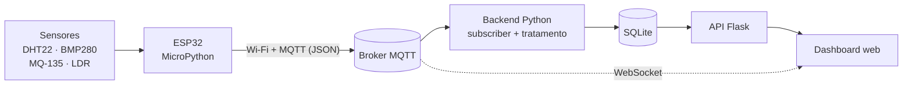
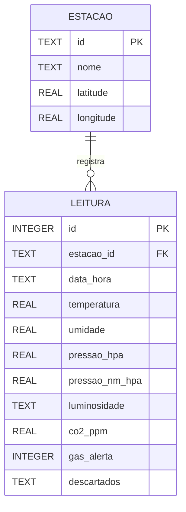

> **Vídeo de demonstração (não listado):** [assista aqui](COLE_AQUI_O_LINK_DO_YOUTUBE_OU_DO_DRIVE)

<div align="center">


# TechGirls Weather Station

**Estação meteorológica inteligente (IoT) com ESP32 e MicroPython**

Mede temperatura, umidade, pressão, qualidade do ar e luminosidade, envia por MQTT
e mostra tudo em um dashboard web com mapa, alertas e histórico.


</div>

---

## Sumário

- [Sobre o projeto](#sobre-o-projeto)
- [Arquitetura](#arquitetura)
- [Hardware](#hardware)
- [Firmware](#firmware)
- [Backend e banco de dados](#backend-e-banco-de-dados)
- [Dashboard](#dashboard)
- [Instalação](#instalação)
- [Estrutura do repositório](#estrutura-do-repositório)
- [Testes](#testes)
- [Limitações e próximos passos](#limitações-e-próximos-passos)
- [Equipe](#equipe)
- [Referências](#referências)

---

## Sobre o projeto

Projeto integrador da disciplina **68F3 – Projeto e Desenvolvimento II** (Ciência da Computação), com o tema **Estação Meteorológica para Cidades Inteligentes**.

[Escreva aqui, em 3 ou 4 linhas, o problema (por exemplo, a falta de monitoramento microclimático local) e por que dados ambientais abertos importam para a gestão urbana e para a transparência com a população.]

---

## Arquitetura



---

## Hardware

| Sensor | Grandeza | Interface | Pino do ESP32 |
|---|---|---|---|
| **DHT22** | temperatura e umidade | 1 fio digital + resistor de 4,7 kΩ | GPIO 15 |
| **BMP280** | pressão atmosférica | I²C (0x76) | SDA GPIO 21 · SCL GPIO 22 |
| **MQ-135** | qualidade do ar (CO₂ estimado) | analógica com divisor 10 kΩ / 20 kΩ · digital | AOUT GPIO 34 · DOUT GPIO 23 |
| **Módulo LDR** | luminosidade (claro ou escuro) | saída digital | GPIO 32 |

> [!NOTE]
> Lógica em **3,3 V** (DHT22, BMP280, LDR) e **5 V** no pino VIN só para o aquecedor do MQ-135.
> O AOUT do MQ-135 passa por um divisor de tensão (5 V → 3,33 V), abaixo do limite de 3,6 V do pino.

<p align="center">
  
</p>

**Fotos do protótipo:** [adicione as fotos em `docs/fotos/` e descomente as linhas abaixo]

<!--
<p align="center">
  
  
</p>
-->

---

## Firmware

Código modular em MicroPython, na pasta [`firmware/`](firmware):

| Arquivo | Função |
|---|---|
| `main.py` | laço principal: lê os sensores, monta o JSON e envia |
| `config.py` | pinos, tópico MQTT, intervalo e constantes |
| `pressao.py` | drivers do BMP280 |
| `mq135.py` | tensão → resistência → ppm de CO₂, com correção por temperatura e umidade |
| `rede.py` | Wi-Fi e publicação MQTT |
| `segredos.py` | nome e senha do Wi-Fi (**não vai para o GitHub**; use `segredos.example.py`) |

Mensagem publicada a cada intervalo:

```json
{"temperatura": 24.4, "umidade": 61.0, "pressao_hpa": 925.4, "pressao_nm_hpa": 1012.6,
 "luminosidade": "claro", "co2_ppm": 640, "gas_alerta": false}
```

---

## Backend e banco de dados

A pasta [`backend/`](backend) (Python + Flask + SQLite) assina o MQTT, **trata os dados** e grava no banco relacional.

- **Faixas físicas:** valores impossíveis (por exemplo, 500 °C) são rejeitados.
- **Outliers:** comparação com as leituras recentes por mediana e MAD; o campo removido fica registrado em `descartados`.
- **Média móvel** nas consultas: `/api/leituras?media_movel=5`.
- **API somente leitura** (GET), sem rotas que alterem ou apaguem dados.
- `consultar_banco.py` mostra as leituras entrando no banco, em tempo real, pelo terminal.

| Rota | O que entrega |
|---|---|
| `/api/saude` | estado da API, do banco e do MQTT |
| `/api/ultima` | leitura mais recente |
| `/api/leituras` | lista com filtros de dia, limite e média móvel |
| `/api/resumo` | mínimo, máximo e média do dia |
| `/api/estacoes` | estações cadastradas, com latitude e longitude |



---

## Dashboard

A pasta [`dashboard/`](dashboard) (HTML, CSS e JavaScript puro, sem bibliotecas) tem:

- boletim ao vivo de cada sensor, com mini-gráficos, mínimo e máximo;
- **alertas de condições extremas** (calor, frio, ar seco ou úmido, ar ruim, gás, pressão baixa ou em queda);
- **mapa** com a posição da estação, calculada com a projeção de Mercator (coordenadas geográficas → plano cartesiano);
- **histórico gravado no banco**, por dia, com média móvel;
- modo escuro automático, layout responsivo e fontes embutidas.

**Demonstração:** [adicione GIFs em `docs/gifs/` e descomente a linha abaixo]

<!--  -->

---

## Instalação

<details>
<summary><b>1. Firmware (ESP32)</b></summary>

1. Grave o MicroPython na placa (uma vez):

   ```bash
   esptool.py --chip esp32 erase_flash
   esptool.py --chip esp32 write_flash -z 0x1000 <arquivo-do-firmware>.bin
   ```

2. Copie `firmware/segredos.example.py` para `firmware/segredos.py` e preencha o Wi-Fi (rede de **2,4 GHz**).
3. Em `firmware/config.py`, confira `SIMULADOR = False` e o `MQTT_TOPICO` (igual ao do dashboard e da API).
4. No Thonny (Arquivo › Salvar como › Dispositivo MicroPython), ou com `mpremote cp`, grave **todos** os arquivos de `firmware/` na placa, com os mesmos nomes. O `main.py` por último.
5. Aperte **F5** no `main.py`. O Shell deve mostrar `Wi-Fi conectado` e `Publicado no topico`.
6. Depois dos testes, troque `INTERVALO_S` de 10 para 60.

</details>

<details>
<summary><b>2. Backend e dashboard (computador)</b></summary>

No VS Code, abra a pasta do repositório e use **Terminal › Executar Tarefa**:

1. `2. Instalar dependências da API (só na primeira vez)`
2. `3. Ligar API + site`
3. Abra **http://127.0.0.1:5050** no navegador.

Ou, pelo terminal:

```bash
cd backend
python -m venv venv
venv\Scripts\activate          # Windows  (macOS/Linux: source venv/bin/activate)
pip install -r requirements.txt
python app.py
```

Para testar sem a placa: `python simular_esp32.py` em outro terminal.

</details>

<details>
<summary><b>3. Configurações úteis</b></summary>

| Quero mudar | Onde |
|---|---|
| coordenadas do mapa | `dashboard/JS/config.js`, em `Estacao.ESTACAO` |
| tópico MQTT | `dashboard/JS/config.js`, `backend/config.py` e `firmware/config.py` |
| limites dos alertas | `dashboard/JS/config.js`, em `Estacao.ALERTAS` |
| intervalo de envio | `firmware/config.py`, em `INTERVALO_S` |

</details>

> [!WARNING]
> Nunca envie `firmware/segredos.py` (senha do Wi-Fi) nem arquivos `.db` para o GitHub. O `.gitignore` já bloqueia os dois.

---

## Estrutura do repositório

```text
TechGirlsWeatherStation/
├─ firmware/      programa do ESP32 (MicroPython)
├─ backend/       API em Python, tratamento de dados e banco SQLite
├─ dashboard/     site: index.html, CSS, JS e SRC
├─ docs/          esquema elétrico, DER, fotos e GIFs
├─ .vscode/       tarefas para ligar tudo com poucos cliques
└─ README.md
```

---

## Testes

> [!IMPORTANT]
> Os casos CT01 a CT04 devem seguir o definido pela disciplina. A tabela abaixo é uma sugestão de organização.

| Caso | O que valida | Evidência |
|---|---|---|
| CT01 | leitura dos sensores no Shell do Thonny | captura do terminal |
| CT02 | publicação MQTT recebida pelo dashboard | captura do dashboard |
| CT03 | gravação no banco e consulta, inclusive o descarte de outlier | saída do `consultar_banco.py` |
| CT04 | alertas, mapa e histórico no dashboard | GIF ou captura |

---

## Limitações e próximos passos

- A montagem em protoboard está sujeita a mau contato e ruído; solução aplicada: [descrever].
- O CO₂ do MQ-135 é uma **estimativa** e depende de calibração do R₀ em ar limpo.
- O broker MQTT usado é público e não tem autenticação.
- **Próximos passos:** placa de circuito impresso (PCB), invólucro com proteção IP65, alimentação solar e hospedagem da API.

---

## Equipe

**TechGirls**

| Nome | Função |
|---|---|
| [Nome 1] | [função] |
| [Nome 2] | [função] |
| [Nome 3] | [função] |
| [Nome 4] | [função] |

---

## Referências

[Liste em ABNT: datasheets (DHT22, BMP280, MQ-135), documentação do MicroPython, do Flask e do protocolo MQTT, e a bibliografia usada no projeto.]

---

<div align="center">

© 2026 Equipe TechGirls. Todos os direitos reservados.

</div>
